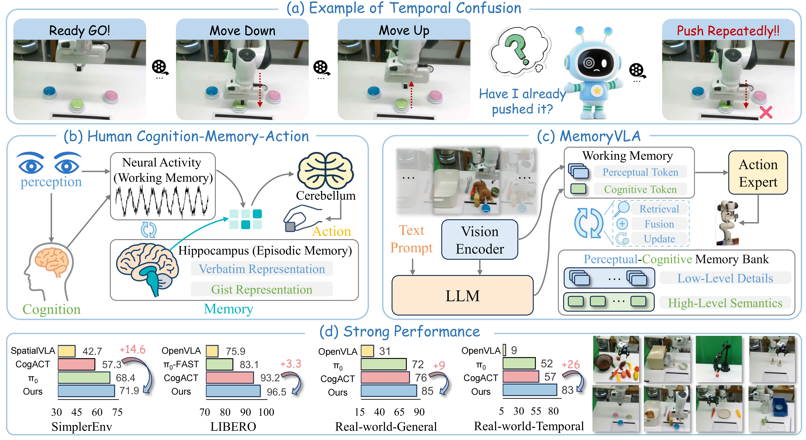

# MemoryVLA：用于机器人操作的视觉语言动作模型中的感知与认知记忆

## 本地TTTchoiceMem实验入口

本文件按用户要求改为中文。下方介绍和分数来自原MemoryVLA项目，**不是本机Qwen实验结果**；英文上游介绍仍可在同级`参考/MemoryVLA/README.md`查看，未修改该参考副本。

当前正式实验为**Qwen + 原版MemoryVLA双Bank + DiT-L，十任务联合训练，4卡DDP、全局64、55000更新**，然后自动进行十任务各50回合的原生RMBench评测。

公司集群另准备**8卡A800、全局128、OFT、55k**独立方案，保持其他有效超参数，尚未在集群执行。新命令默认主相机单图，可用`--cameras`选1～3路、`--action-head oft|diffusion`切换头、`--workers-per-gpu 1|2|3`选择每卡评测并发，8卡最高24路；完整命令见操作手册第11～12节。本机运行中DiT-L模型不切换、不重启。

- [中文训练与评测操作手册](README_full_finetuning.md)：当前环境、完整训练/恢复/评测命令、tmux、保存位置、checkpoint磁盘占用。
- [中文模型与数据说明](README_lightweight.md)：Qwen、两套Bank、动作头、可选相机与原生14维数据适配。
- [中文实验日记](../document/experimental%20diary/2026-10-13_TTTchoiceMem_Qwen全量微调_DiTL_全局64_55k.md)：实际准备、启动、耗时与清理记录。

**当前任务已经运行，不要按下面原版安装/训练示例重新安装依赖或重复启动。** 本地训练使用`.venv-qwen35-host512`，模拟器使用`.venv-rmbench-host512`，具体路径见操作手册；原版`pyproject.toml`与当前Qwen依赖并不相同。11个非正式run目录和7个验收脚本已按用户要求删除，当前正式代码、环境、资产和数据保留。

## 原MemoryVLA项目与作者

[Hao Shi](https://shihao1895.github.io/), [Bin Xie](https://xb534.github.io/), [Yingfei Liu](https://scholar.google.com/citations?user=pF9KA1sAAAAJ), [Lin Sun](https://github.com/linsun449), [Fengrong Liu](https://shihao1895.github.io/MemoryVLA/) [Tiancai Wang](https://scholar.google.com/citations?user=YI0sRroAAAAJ), [Erjin Zhou](https://scholar.google.com/citations?user=k2ziPUsAAAAJ), [Haoqiang Fan](https://scholar.google.com/citations?user=bzzBut4AAAAJ), [Xiangyu Zhang](https://scholar.google.com/citations?user=yuB-cfoAAAAJ), [Gao Huang](https://scholar.google.com/citations?user=-P9LwcgAAAAJ)

清华大学、Dexmal、旷视、天津大学、哈尔滨工业大学、阶跃星辰

ICLR 2026

> 本工程基于论文《MemoryVLA：用于机器人操作的视觉语言动作模型中的感知与认知记忆》的代码，并添加了独立Qwen/RMBench适配。

### [MemoryVLA项目](https://shihao1895.github.io/MemoryVLA) | [MemoryVLA++项目](https://shihao1895.github.io/MemoryVLA-PP-Web) | [论文](https://arxiv.org/abs/2508.19236) | [模型与日志](https://huggingface.co/collections/shihao1895/memoryvla)

## 上游动态

- [2026-6-9] 扩展期刊版本[MemoryVLA++](https://shihao1895.github.io/MemoryVLA-PP-Web)已发布。
- [2026-1-27] [MemoryVLA论文](https://arxiv.org/abs/2508.19236)被ICLR 2026接收。
- [2025-11-5] [MemoryVLA](https://arxiv.org/abs/2508.19236)代码发布，包括MemoryVLA和MemoryVLA+。
- [2025-10-20] [Dexbotic](https://github.com/Dexmal/dexbotic)代码库发布，已集成MemoryVLA。
- [2025-8-26] [MemoryVLA论文](https://arxiv.org/abs/2508.19236)上线arXiv。

## 方法概述

MemoryVLA是受人类记忆系统启发的认知—记忆—动作框架，通过类似海马体的感知/认知记忆捕捉当前决策所需的时间依赖，实现长时序、时间感知的机器人动作生成。



上游以不同分支提供以下版本：

- **[MemoryVLA](https://github.com/shihao1895/MemoryVLA/tree/openvla-codebase)**：基于OpenVLA代码库。
- **[MemoryVLA+](https://github.com/shihao1895/MemoryVLA/tree/dexbotic-codebase)**：基于自研[Dexbotic](https://dexbotic.com)代码库，提供更高模拟性能。
- **MemoryVLA++**：MemoryVLA的扩展期刊版本。

## 上游发布进度

以下保留原README的发布清单；项目网页发布不代表所有代码、数据和权重都已开放：

- [x] MemoryVLA（OpenVLA代码库）
  - [x] 代码发布
  - [x] 模型权重发布
  - [x] 数据上传HuggingFace

- [x] MemoryVLA+（Dexbotic代码库）
- [ ] MemoryVLA++（扩展期刊版本）
  - [ ] 代码发布
  - [ ] 模型权重发布
  - [ ] 数据上传HuggingFace


## 原版说明目录

本地保留的是基于OpenVLA的MemoryVLA源码；需要Dexbotic版本时应选择[MemoryVLA+](https://github.com/shihao1895/MemoryVLA/tree/dexbotic-codebase)，不要混用两分支的checkpoint/动作协议。

 * [模型与上游基准结果](#模型与上游基准结果)
 * [原版安装说明](#原版安装说明)
 * [原版LIBERO评测](#原版libero评测)
 * [原版SimplerEnv评测](#原版simplerenv评测)
 * [原版训练说明](#原版训练说明)
 * [原版真实机器人部署](#原版真实机器人部署)
 * [常见问题](#常见问题)
 * [引用](#引用)

## 模型与上游基准结果

> 以下原上游结果逐项保留，不是当前Qwen + DiT-L十任务模型的成功率。MemoryVLA表示OpenVLA代码库版本，MemoryVLA+表示Dexbotic版本；“未发布”对应原表TBD。

### Libero

| 模型             | 空间 | 物体 | 目标 | 长程10 | 长程90 | 平均 | 权重与日志 |
| ---------------- | ------- | ------ | ---- | ------- | ------- | ---- | ------------------------------------------------------------ |
| MemoryVLA        | 98.4    | 98.4   | 96.4 | 93.4    | 95.6    | 96.5 | [🤗 Spa](https://huggingface.co/shihao1895/memvla-libero-spatial), [🤗 Obj](https://huggingface.co/shihao1895/memvla-libero-object), [🤗 Goal](https://huggingface.co/shihao1895/memvla-libero-goal), [🤗 100](https://huggingface.co/shihao1895/memvla-libero-100) |
| MemoryVLA+       | 98.2    | 97.8   | 96.4 | 93.6    | 96.2    | 96.5 | [🤗 Spa](https://huggingface.co/shihao1895/memvla-plus-libero-spatial), [🤗 Obj](https://huggingface.co/shihao1895/memvla-plus-libero-object), [🤗 Goal](https://huggingface.co/shihao1895/memvla-plus-libero-goal), [🤗 100](https://huggingface.co/shihao1895/memvla-plus-libero-100) |
| MemoryVLA+ (mix) | 97.2    | 99.2   | 98.4 | 93.2    | 97.2    | 97.1 | [🤗 HF](https://huggingface.co/shihao1895/memvla-plus-libero-mix) |
| MemoryVLA++      | 99.8    | 100.0  | 98.2 | 96.0    | 97.8    | 98.4 | 未发布 |

### SimplerEnv-Bridge

| 模型 | 勺子 | 胡萝卜 | 方块 | 茄子 | 平均 | 权重与日志 |
| ----------- | ----- | ------ | ---- | -------- | ---- | ------------------------------------------------------------ |
| MemoryVLA   | 75.0  | 75.0   | 37.5 | 100.0    | 71.9 | [🤗 HF](https://huggingface.co/shihao1895/memvla-bridge)      |
| MemoryVLA+  | 100.0 | 66.7   | 70.8 | 100.0    | 84.4 | [🤗 HF](https://huggingface.co/shihao1895/memvla-plus-bridge) |
| MemoryVLA++ | 83.3  | 66.7   | 45.8 | 100.0    | 73.9 | 未发布 |

### Mikasa-Robo

| 模型 | SGT | IM | RC3 | RC5 | RC9 | 平均 | 权重与日志 |
| ----------- | ---- | ---- | ---- | ---- | ---- | ---- | ------------------------------------------------------- |
| MemoryVLA   | 88   | 24   | 44   | 30   | 20   | 41.2 | [🤗 HF](https://huggingface.co/shihao1895/memvla-mikasa) |
| MemoryVLA++ | 97   | 40   | 50   | 19   | 16   | 44.4 | 未发布 |

### Libero-Plus

| 模型 | 相机 | 机器人 | 语言 | 光照 | 背景 | 噪声 | 布局 | 平均 | 权重与日志 |
| ----------------- | ---- | ---- | ---- | ----- | ----- | ---- | ------ | ---- | ----------- |
| MemoryVLA         | 42.7 | 44.9 | 84.4 | 92.8  | 95.0  | 62.1 | 84.7   | 70.2 | 未发布 |
| MemoryVLA++       | 36.4 | 68.9 | 88.7 | 93.8  | 90.6  | 63.5 | 83.8   | 73.1 | 未发布 |
| MemoryVLA (SFT)   | 91.4 | 48.6 | 79.4 | 95.2  | 95.3  | 94.0 | 75.7   | 81.9 | 未发布 |
| MemoryVLA++ (SFT) | 96.8 | 49.7 | 71.0 | 96.6  | 97.0  | 96.0 | 78.6   | 82.7 | 未发布 |

### Calvin

| 模型 | 1 | 2 | 3 | 4 | 5 | 平均 | 权重与日志 |
| ----------- | ---- | ---- | ---- | ---- | ---- | ---- | ----------- |
| MemoryVLA   | 94.8 | 87.4 | 81.4 | 75.9 | 69.4 | 4.09 | 未发布 |
| MemoryVLA++ | 95.6 | 90.2 | 85.7 | 81.7 | 76.1 | 4.29 | 未发布 |

### Fractal-VM

| 模型 | 可乐罐 | 移近 | 开关抽屉 | 放入抽屉 | 平均 | 权重与日志 |
| ---------- | -------- | --------- | ----------------- | ------------- | ---- | ------------------------------------------------------------ |
| MemoryVLA  | 90.7     | 88.0      | 84.7              | 47.2          | 77.7 | [🤗 HF](https://huggingface.co/shihao1895/memvla-fractal)     |
| MemoryVLA+ | 92.0     | 91.7      | 71.8              | -             | -    | [🤗 HF](https://huggingface.co/shihao1895/memvla-plus-fractal) |

### Fractal-VA

| 模型 | 可乐罐 | 移近 | 开关抽屉 | 放入抽屉 | 平均 | 权重与日志 |
| ---------- | -------- | --------- | ----------------- | ------------- | ---- | ------------------------------------------------------------ |
| MemoryVLA  | 80.5     | 78.8      | 53.2              | 58.3          | 67.7 | [🤗 HF](https://huggingface.co/shihao1895/memvla-fractal)     |
| MemoryVLA+ | 83.5     | 81.8      | 63.2              | -             | -    | [🤗 HF](https://huggingface.co/shihao1895/memvla-plus-fractal) |

### Maniskill2

| 模型 | 拾取方块 | 堆叠方块 | 拾取单个YCB | 拾取单个EGAD | 杂乱YCB拾取 | 平均 | 权重与日志 |
| ---------- | --------- | ---------- | --------------- | ---------------- | ---------------- | ---- | ------------------------------------------------------------ |
| MemoryVLA+ | 85        | 75         | 60              | 85               | 45               | 70   | [🤗 HF](https://huggingface.co/shihao1895/memvla-plus-maniskill2) |

## 原版安装说明

**本节是上游环境说明，不适用于本次Qwen训练，不要在当前项目环境执行。** 原版使用Python3.10、PyTorch2.2.0与CUDA12.1；更低版本可能运行，但上游未测试。

上游推荐[Miniconda](https://docs.conda.io/en/latest/miniconda.html)，并使用独立的`memvla`环境。以下保留原版命令作参考，当前已准备好的环境不需要重建：
```bash
conda create --name memvla python=3.10
conda activate memvla

pip install torch==2.2.0 torchvision==0.17.0 torchaudio==2.2.0 --index-url https://download.pytorch.org/whl/cu121
conda install -c nvidia cuda-nvcc=12.1 cuda-toolkit=12.1 -y
```
原版训练还使用[Flash Attention](https://github.com/Dao-AILab/flash-attention)2.5.5。示例wheel必须匹配Python、torch、CUDA和C++ ABI，不可直接套用于当前Qwen环境：

```bash
# 原版PyTorch2.2/CUDA12.1的示例，不适用于当前Qwen环境
wget https://github.com/Dao-AILab/flash-attention/releases/download/v2.5.5/flash_attn-2.5.5+cu122torch2.2cxx11abiFALSE-cp310-cp310-linux_x86_64.whl
pip install flash_attn-2.5.5+cu122torch2.2cxx11abiFALSE-cp310-cp310-linux_x86_64.whl
```

上游安装流程是在独立原版工程中克隆[MemoryVLA](https://github.com/shihao1895/MemoryVLA)后执行`pip install -e .`。当前工程已经准备，不要重复克隆、覆盖源码或执行此安装来降级依赖。

上游对NVIDIA Hopper GPU（如H20）的`Floating point exception (core dumped)`错误建议尝试下面的cuBLAS版本；这是历史排障建议，不是本机4090任务的必要操作：

```bash
# 原版H20错误排查示例，不在本次运行中执行
pip install nvidia-cublas-cu12==12.4.5.8
```

## 原版LIBERO评测

上游提供[LIBERO](https://libero-project.github.io/intro.html)评测接口和脚本。**本次RMBench评测使用独立`eval_multitask.py`，不是这些脚本。**

1. 原版要求按[LIBERO仓库](https://github.com/Lifelong-Robot-Learning/LIBERO)指南准备模拟器，并放到原工程的`third_libs/LIBERO`。

2. 本地原版脚本路径示例，需要原版模型/环境和相应配置，不能对当前训练重复启动：

   ```bash
   # 原版LIBERO评测
   bash /mnt/data/dylan/d2/memory/TTTchoiceMem/script/eval/libero/eval_libero.sh
   # 原版结果汇总
   python /mnt/data/dylan/d2/memory/TTTchoiceMem/script/eval/libero/extract_libero_results.py
   ```

   > 原版流程先启动模型服务，再运行`evaluation/libero/eval_libero.py`。原README写作`develop.py`，本地实际保留的部署入口名为`deploy.py`，应以脚本实际内容为准。上游建议评测多个checkpoint并报告最好结果；**当前RMBench正式协议固定最终55k权重，不按结果挑checkpoint或重跑。**

## 原版SimplerEnv评测

上游还提供[SimplerEnv](https://simpler-env.github.io/)评测接口和脚本，和本次RMBench协议不同。

1. 原版要求按[SimplerEnv仓库](https://github.com/simpler-env/SimplerEnv)指南准备模拟器，并放到原工程的`third_libs/SimplerEnv`。

2. 本地原版Bridge脚本路径示例：

   ```bash
   # 原版Bridge评测
   bash /mnt/data/dylan/d2/memory/TTTchoiceMem/script/eval/bridge/eval_bridge.sh
   # 原版结果汇总
   python /mnt/data/dylan/d2/memory/TTTchoiceMem/script/eval/bridge/extract_bridge_results.py
   ```

   > 上游认为SimplerEnv环境和扩散采样使不同checkpoint分数波动较大，建议每2500步评测并报告最好值。此说明仅描述原版习惯，**不更改本地固定最终55k/500回合的协议**。

## 原版训练说明

1. 原版使用[RLDS](https://github.com/google-research/rlds)格式的数据，不是当前原生RMBench HDF5：

   - [LIBERO](https://libero-project.github.io/intro.html)：空间、物体、目标、长程10和长程90任务集。
   - [Open X-Embodiment（OXE）](https://robotics-transformer-x.github.io/)中的Bridge数据。
   - [Open X-Embodiment（OXE）](https://robotics-transformer-x.github.io/)中的Fractal数据。

   数据下载需要[git-lfs](https://git-lfs.com)，上游数据地址分别为[LIBERO RLDS（约22GB）](https://huggingface.co/datasets/shihao1895/libero-rlds)、[Bridge RLDS（约157GB）](https://huggingface.co/datasets/shihao1895/bridge-rlds)、[Fractal RLDS](https://huggingface.co/datasets/shihao1895/fractal-rlds)。当前十任务原生数据已在本机，不需要下载这些数据来继续当前实验。

2. 原版LIBERO训练使用[OpenVLA预训练模型](https://huggingface.co/openvla/openvla-7b-prismatic)（约30GB），Bridge/Fractal使用[CogACT预训练模型](https://huggingface.co/CogACT/CogACT-Large)（约31GB）。当前实验只使用固定官方Qwen主干，不复用它们的7维动作权重。

3. 原版不同数据集训练脚本需要先配置`hf_token`、`wandb_entity`、权重、数据和日志路径。上游训练硬件为单节点8张NVIDIA A100，下列本地脚本仅作原版入口参考：

   ```bash
   # 原版Bridge训练
   bash /mnt/data/dylan/d2/memory/TTTchoiceMem/script/train/bridge/train_bridge.sh
   # 原版LIBERO空间任务训练
   bash /mnt/data/dylan/d2/memory/TTTchoiceMem/script/train/libero/train_libero_spatial.sh
   # 原版LIBERO物体任务训练
   bash /mnt/data/dylan/d2/memory/TTTchoiceMem/script/train/libero/train_libero_object.sh
   # 原版LIBERO目标任务训练
   bash /mnt/data/dylan/d2/memory/TTTchoiceMem/script/train/libero/train_libero_goal.sh
   # 原版LIBERO-100训练
   bash /mnt/data/dylan/d2/memory/TTTchoiceMem/script/train/libero/train_libero_100.sh
   # 原版Fractal训练
   bash /mnt/data/dylan/d2/memory/TTTchoiceMem/script/train/fractal/train_fractal.sh
   # 原版真实机器人数据训练
   bash /mnt/data/dylan/d2/memory/TTTchoiceMem/script/train/real_world/train_real.sh
   ```

   原版自定义数据转换见[rlds_dataset_builder](https://github.com/kpertsch/rlds_dataset_builder)，动作是末端位移3维、旋转3维和夹爪1维，存放到`<data_root_dir>/custom_finetuning/1.0.0`并设置`vla.data_mix="custom_finetuning"`。**这与本次14维绝对关节驱动目标不同，不可混用标签、归一化或部署接口。**

## 原版真实机器人部署

原版部署建议先采集对应机器人的操作数据（例如遥操作），再微调预训练模型。

原版服务端/客户端示例见[`deploy.py`](deploy.py)，不要将其7维末端动作服务与当前`serve_rmbench.py`的14维原生协议混用。

原版服务器脚本为：
```bash
bash /mnt/data/dylan/d2/memory/TTTchoiceMem/script/eval/real_world/deploy.sh
```

机器人作为客户端，原版每次请求发送图像、文本和回合首帧标记以获得动作块。`episode_first_frame`是字符串`'True'`或`'False'`，表示是否为回合第一帧：

```python
image = request.files['image']
query = request.form['text']
episode_first_frame = request.form['episode_first_frame']
```

该原版接口参考[OpenVLA](https://github.com/openvla/openvla)和[CogACT](https://github.com/microsoft/CogACT)的设计。真实机器人部署前需额外验证动作单位、限位、停止机制和安全性，本次模拟评测通过不自动证明真机安全。

## 常见问题

下面保留上游SimplerEnv/ManiSkill安装排障经验，属于原版说明，不要求修改本机共享环境。

**（1）Vulkan/SAPIEN依赖**

示例错误原文：
ImportError: libvulkan.so.1: cannot open shared object file: No such file or directory
Some required Vulkan extension is not present. You may not use the renderer to render, however, CPU resources will be still available.

上游建议安装以下系统库，执行前需确认系统权限及共享环境影响：

```bash
sudo apt install -y libegl1-mesa libgl1-mesa-dev libgles2-mesa-dev
```

参考：
https://maniskill.readthedocs.io/en/latest/user_guide/getting_started/installation.html#troubleshooting

> 检查Vulkan的`.json`是否指向当前NVIDIA驱动对应的`.so`；用`nvidia-smi`查看驱动，必要时检查`/usr/lib/x86_64-linux-gnu/`中的库。当前模拟器已经独立验收，不要因阅读本节而重新安装驱动。

**（2）OpenGL依赖**

示例错误原文：
ImportError: libGL.so.1: cannot open shared object file: No such file or directory

上游排障安装示例：

```bash
sudo apt install -y libgl1 libglib2.0-0 libglx-mesa0 libopengl0 libglu1-mesa mesa-utils
```

**（3）SimplerEnv视频录制**

```bash
sudo apt install -y ffmpeg
```

**（4）基准分数波动**

上游指出不同训练步数、扩散采样和conda包版本可能影响分数，SimplerEnv尤为明显，并建议周期性评测/报告最好checkpoint。本次原生RMBench实验不照搬“挑最好结果”：固定最终55k权重和候选seed池、完整500回合覆盖，不按策略结果重跑。

## 引用

使用上游工作时，请考虑引用[MemoryVLA论文](https://arxiv.org/abs/2508.19236)。下方BibTeX保持原文，作者、题名及条目键不翻译：

```bibtex
@article{shi2025memoryvla,
  title={MemoryVLA: Perceptual-Cognitive Memory in Vision-Language-Action Models for Robotic Manipulation},
  author={Shi, Hao and Xie, Bin and Liu, Yingfei and Sun, Lin and Liu, Fengrong and Wang, Tiancai and Zhou, Erjin and Fan, Haoqiang and Zhang, Xiangyu and Huang, Gao},
  journal={arXiv preprint arXiv:2508.19236},
  year={2025}
}

@article{shi2026memoryvla++,
  title={MemoryVLA++: Temporal Modeling via Memory and Imagination in Vision-Language-Action Models},
  author={Shi, Hao and Li, Weiye and Xie, Bin and Wang, Yulin and Zhou, Renping and Wang, Tiancai and Zhang, Xiangyu and Luo, Ping and Huang, Gao},
  journal={arXiv preprint arXiv:2606.09827},
  year={2026}
}

@article{dexbotic,
  title={Dexbotic: Open-Source Vision-Language-Action Toolbox},
  author={Dexbotic Contributors},
  journal={arXiv preprint arXiv:2510.23511},
  year={2025}
}
```
